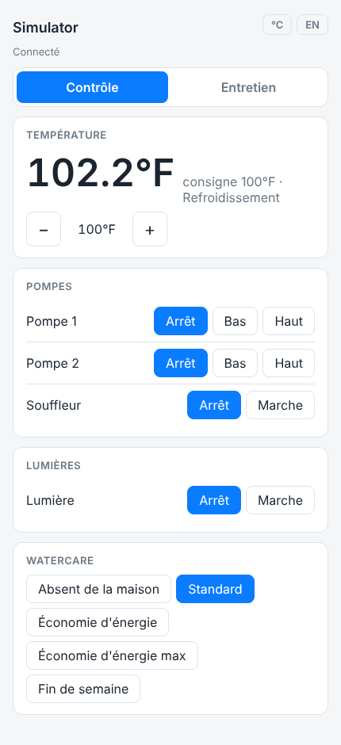
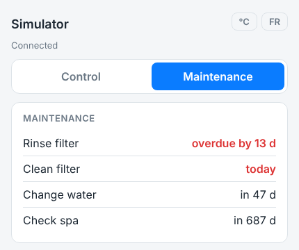

# spaweb — contrôle local d'un spa Gecko in.touch 2

🇬🇧 [English version](README.md)

> **Projet non officiel**, non affilié à Gecko Alliance. Il repose sur [geckolib](https://github.com/gazoodle/geckolib) (GPL v3) de Gazoodle.
> Testé avec un module in.touch 2 et un Raspberry Pi 1 Modèle B (Raspberry Pi OS Trixie, Python 3.13). Autres spas ou modules: non testés.

> ⚠️ **Sécurité**: pas de HTTPS, authentification HTTP de base (mot de passe envoyé en clair), pas de protection CSRF.
> À utiliser seulement sur un réseau local de confiance ou derrière un VPN. **Ne jamais l'exposer à Internet.**

Serveur web minimal au-dessus de [geckolib](https://github.com/gazoodle/geckolib).
Aucun cloud Gecko: il parle en UDP au module in.touch 2 sur le réseau local.

## Captures d'écran
Prises avec le simulateur de geckolib (pas un vrai spa) : les valeurs, y compris les rappels en retard, sont des données de test.

| Contrôle | Entretien |
|---|---|
|  |  |

## Prérequis
- Python 3.13 ou plus (geckolib 1.x l'exige). Raspberry Pi OS « Trixie » (Debian 13) l'inclut;
  sur « Bookworm » (Python 3.11), installer 3.13 avec `uv` (`curl -LsSf https://astral.sh/uv/install.sh | sh`,
  puis `uv venv --python 3.13 venv`).
- Le Pi doit pouvoir joindre l'IP du module en UDP (idéalement même segment réseau).

## Installation
    mkdir -p ~/spaweb && cd ~/spaweb      # copier server.py, static/, requirements.txt ici
    python3.13 -m venv venv && . venv/bin/activate
    pip install -r requirements.txt
    cp spaweb.env.example spaweb.env && chmod 600 spaweb.env   # éditer IP et mot de passe
    set -a; . ./spaweb.env; set +a; python server.py            # test, puis http://<ip-du-pi>:8080

## Service au démarrage
    sudo cp spaweb.service /etc/systemd/system/
    sudo systemctl enable --now spaweb
    journalctl -u spaweb -f

## Accès à distance
Ne pas rediriger le port 8080 vers Internet: l'authentification est de base (HTTP), sans chiffrement.
Utiliser un VPN (WireGuard ou Tailscale) vers le réseau, puis ouvrir http://<ip-du-pi>:8080.

## API
GET /api/state · POST /api/pump/{i} {"mode":"HI"} · /api/blower/{i} · /api/light/{i} {"on":true}
POST /api/setpoint {"value":37.5} · /api/watercare {"mode":"Standard"}
Page: bouton °C/°F (affichage seulement, le spa garde son unité; ?unit=F force l'unité) et bouton FR/EN en haut à droite (choix mémorisé dans le navigateur; ?lang=en force la langue).
Page: / = onglet Contrôle, /#entretien = onglet Entretien (rappels du spa pack)

## Fausses alertes
Les codes OverTemp, VSP1CommLost et VSP2CommLost sont ignorés par défaut (l'application Gecko n'en signalait aucun).
Pour changer la liste: SPA_IGNORE_ALERTS=code1,code2 ; une valeur vide (SPA_IGNORE_ALERTS=) affiche toutes les alertes.

## Licence
GPL v3 (voir `LICENSE`), comme geckolib dont ce projet dépend. Fourni tel quel, sans garantie: vous contrôlez un équipement réel (chauffage, pompes), à vos risques.
