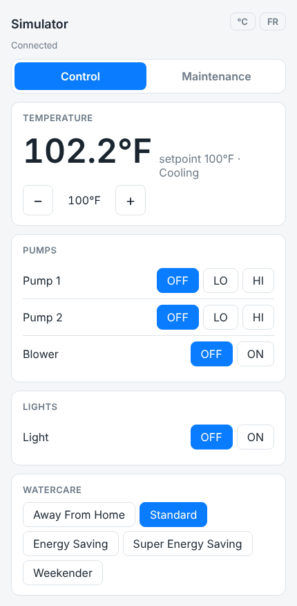
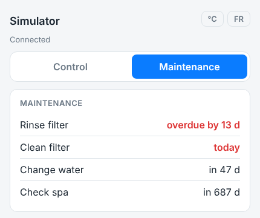

# spaweb — local control for Gecko in.touch 2 spas

🇫🇷 [Version française](README.fr.md)

A minimal web interface for a Gecko spa fitted with an **in.touch 2** module. It runs on your own network (for example on a Raspberry Pi) and talks to the module over UDP. **No Gecko cloud and no subscription.**

> **Unofficial project**, not affiliated with Gecko Alliance. It is built on [geckolib](https://github.com/gazoodle/geckolib) (GPL v3) by Gazoodle.
> Tested with one in.touch 2 module and a Raspberry Pi 1 Model B (Raspberry Pi OS Trixie, Python 3.13). Other spas or modules: untested.

> ⚠️ **Security**: no HTTPS, HTTP Basic authentication (the password travels in clear text), no CSRF protection.
> Use it only on a trusted local network or behind a VPN. **Never expose it to the Internet.**

## What it does
- **Control tab**: water temperature and setpoint (°C or °F), pumps, blower, lights, Watercare mode.
- **Maintenance tab**: the spa pack's reminders (filter cleaning, water change, and so on).
- French / English interface, with a °C / °F display toggle.
- Hides three alert codes by default (see "False alerts" below).

## Screenshots
Taken with the geckolib simulator (not a real spa), so the values, including the overdue reminders, are test data.

| Control | Maintenance |
|---|---|
|  |  |

The same page in French: [`docs/control-fr.png`](docs/control-fr.png).

## Requirements
- Python 3.13 or newer (geckolib 1.x requires it). Raspberry Pi OS "Trixie" (Debian 13) includes it.
  On "Bookworm" (Python 3.11), install 3.13 with `uv` (`curl -LsSf https://astral.sh/uv/install.sh | sh`, then `uv venv --python 3.13 venv`).
- The machine running spaweb must reach the module's IP address over UDP (ideally on the same network segment).

## Installation
    mkdir -p ~/spaweb && cd ~/spaweb      # copy server.py, static/, requirements.txt here
    python3.13 -m venv venv && . venv/bin/activate
    pip install -r requirements.txt
    cp spaweb.env.example spaweb.env && chmod 600 spaweb.env   # edit the module IP and the password
    set -a; . ./spaweb.env; set +a; python server.py            # test, then open http://<host-ip>:8080

Configuration is read from environment variables (see `spaweb.env.example`): `SPA_ADDRESS` (the module's IP), `SPA_WEB_USER`, `SPA_WEB_PASSWORD`, `PORT`. `ALLOW_NO_AUTH=1` disables the password, for local testing only.

## Start at boot (systemd)
`spaweb.service` assumes the user `pi` and the folder `/home/pi/spaweb`; edit `User=`, `WorkingDirectory=`, `EnvironmentFile=` and `ExecStart=` to match your setup.

    sudo cp spaweb.service /etc/systemd/system/
    sudo systemctl enable --now spaweb
    journalctl -u spaweb -f

## Remote access
Do not forward port 8080 to the Internet: authentication is HTTP Basic, without encryption.
Use a VPN (WireGuard or Tailscale) into your network, then open `http://<host-ip>:8080`.

## Page options
- `/` opens the Control tab, `/#entretien` opens the Maintenance tab.
- `?lang=en` or `?lang=fr` forces the language; `?unit=C` or `?unit=F` forces the temperature unit (display only, the spa keeps its own unit). The choices are remembered in the browser.

## API
    GET  /api/state
    POST /api/pump/{i}      {"mode":"HI"}
    POST /api/blower/{i}
    POST /api/light/{i}     {"on":true}
    POST /api/setpoint      {"value":37.5}
    POST /api/watercare     {"mode":"Standard"}

## False alerts
The codes `OverTemp`, `VSP1CommLost` and `VSP2CommLost` are ignored by default: on the author's spa they were reported while the official app showed no alert. Change the list with `SPA_IGNORE_ALERTS=code1,code2`; an empty value (`SPA_IGNORE_ALERTS=`) shows every alert. The spa pack's own safety functions are not affected.

## License
GPL v3 (see `LICENSE`), like geckolib, on which this project depends. Provided as is, without any warranty: you are controlling real equipment (heating, pumps), at your own risk.
